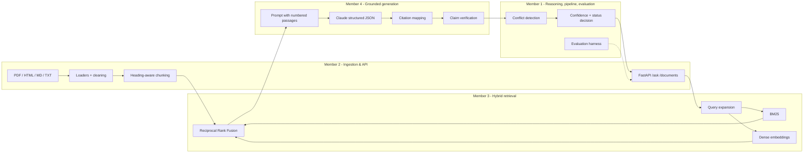

# Enterprise Documentation Q&A Assistant

HCLTech AI Engineer Hackathon — end-to-end AI-powered solution developed by a four-member engineering squad.

Ask natural-language questions over PDF, HTML, Markdown and TXT documentation and get a **concise answer
grounded only in the supplied documents**, with **citations** (document, section/page, excerpt), **visible
conflicts** between versions, and a clear **not-found / clarification** response when evidence is weak.

> Status: **project skeleton**. Contracts, mocks, tests and module signatures are in place; each member
> implements their module on their own feature branch. See [CLAUDE.md](CLAUDE.md) for the rules and ownership.

## Architecture



More detail: [docs/ARCHITECTURE.md](docs/ARCHITECTURE.md). Team Git workflow: [docs/TEAM_WORKFLOW.md](docs/TEAM_WORKFLOW.md).

## Setup

```bash
python -m venv .venv
# Windows: .venv\Scripts\activate     macOS/Linux: source .venv/bin/activate
pip install -r requirements.txt
cp .env.example .env        # then put your ANTHROPIC_API_KEY in .env (never commit it)
python -m pytest            # contract tests pass; unimplemented module tests show as xfail
python -m scripts.mock_e2e  # walk through the four modules with mock data
uvicorn src.api.app:app --reload   # Swagger UI at http://127.0.0.1:8000/docs
```

No API key? Set `QA_GENERATION__PROVIDER=extractive` to run fully offline.

## Supported formats

PDF (`pypdf`, page numbers kept), HTML (`beautifulsoup4`, h1–h6 sections), Markdown (`#` headings), TXT (heuristic headings).

## Indexing and retrieval approach

Heading-aware chunks (~300 tokens, 50 overlap, never crossing sections) → BM25 (exact terms, error codes)
+ MiniLM sentence embeddings (paraphrases) → Reciprocal Rank Fusion → optional cross-encoder re-rank.
Query expansion with a small enterprise glossary (`config/glossary.yaml`).

## Answering approach

Top passages are numbered and sent to Claude with strict grounding instructions; output is validated JSON
(answer, claims with passage numbers, insufficient-evidence and conflict flags). Each claim is verified
against its cited passage (numbers must match); unsupported claims are dropped. A deterministic decision
layer returns `answered`, `conflict`, `needs_clarification` or `not_found` with a confidence score.

## Evaluation

`python -m src.evaluation.run_eval` → `reports/eval_report.md`: Recall@k, MRR, nDCG@k (BM25 vs dense vs hybrid),
groundedness, citation precision, status accuracy per question category, failure cases.
The labelled set in `data/eval/questions.jsonl` and the sample corpus in `data/sample_docs/` are **synthetic and
created by the team**; construction and assumptions are documented in the evaluation report.

## Assumptions and trade-offs

* Small corpus → in-memory numpy index instead of a vector DB (simpler, explainable, fast enough).
* Deterministic conflict/confidence rules instead of an LLM judge → reproducible and defensible; may miss subtle contradictions.
* Relevance labels at doc+section level → survive chunking changes; coarser than passage-level labels.

## Team

| Member | Module | Branch |
|--------|--------|--------|
| Member 1 — Team Lead | Conflict detection, confidence/fallback, pipeline, evaluation | `feature/member-1-reasoning-evaluation` |
| Member 2 | Multi-format ingestion, chunking, FastAPI service | `feature/member-2-ingestion-api` |
| Member 3 | Hybrid retrieval (BM25 + embeddings + RRF + query expansion) | `feature/member-3-hybrid-retrieval` |
| Member 4 | Grounded generation, citations, claim verification | `feature/member-4-grounded-generation` |
