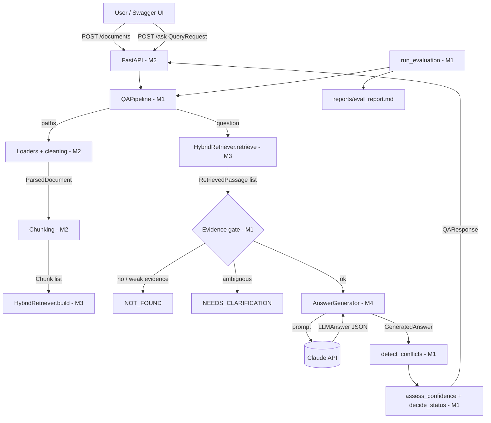

# Problem explanation, architecture and work division

## Part 1 — The problem in plain language

**Business problem.** Employees keep asking the same questions (how do I get access, what is the rate
limit, can I get a refund, how do I fix error X). The answers exist, but they are scattered across
manuals, FAQs, release notes and support articles — and some of those documents are outdated or disagree.
People waste time and sometimes act on the wrong (old) answer.

**What we build.** A documentation assistant: you upload documents, ask a question in normal English, and it
(1) finds the most relevant passages, (2) writes a short answer **only from those passages**, (3) shows
where each statement came from, (4) shows when sources disagree, and (5) says "I don't know / please clarify"
instead of guessing.

This pattern is called **RAG — Retrieval-Augmented Generation**: retrieve evidence first, then let an LLM
generate an answer constrained to that evidence.

### Stated in the brief vs. our recommendations

| Topic | Official brief says | Our recommendation (not mandated) |
|---|---|---|
| Formats | PDF, HTML, Markdown, TXT; keep title/section/source | pypdf, BeautifulSoup, regex headings |
| Preparation | clean + segment, keep headings/context | heading-aware ~300-token chunks, 50 overlap |
| Retrieval | rank passages, handle paraphrases & terminology | BM25 + MiniLM embeddings + RRF + glossary expansion |
| Answer | concise, only retrieved evidence | Claude with structured JSON output + claim verification |
| Citations | doc, section/page, excerpt, link/identifier per claim | `[n]` markers mapped to `Citation` objects |
| Conflicts | detect contradictory/version-sensitive passages, show them | deterministic rules on version/date/numbers |
| Fallback | flag weak evidence, ask for context, clear not-found | score thresholds + groundedness gate |
| Evaluation | labelled set incl. answerable, ambiguous, unanswerable | Recall@k, MRR, nDCG, groundedness, status accuracy |
| Interface | web UI **or** API | FastAPI + Swagger UI (optional thin Streamlit later) |
| Model | **not specified** | Claude `claude-opus-5-5` via `anthropic` SDK; offline extractive fallback |
| Chunking/indexing approach | candidate's choice | as above |

### Functional requirements broken down

* **FR-01 Ingestion** — accept several files; detect type; extract text; keep `title`, `section`, `page`, `source`.
* **FR-02 Preparation** — remove boilerplate (nav, scripts, headers/footers), normalise whitespace, split into
  passages that keep their heading path so "Refunds" text still knows it belongs to "Billing Policy 2026".
* **FR-03 Retrieval** — given "I forgot my login" find the "Password reset" passage (paraphrase), and given
  "HTTP 429" find the rate-limit passage (exact term). Return a ranked list.
* **FR-04 Grounded answer** — the answer may only contain facts present in the retrieved passages.
* **FR-05 Citations** — every claim points to a passage: document title, section/page, verbatim excerpt, id.
* **FR-06 Conflicts** — v1 FAQ says 100 req/min, v2 docs say 300 req/min → show both, labelled by version/date.
* **FR-07 Confidence & fallback** — weak evidence → low confidence flag; vague question → clarifying question;
  nothing relevant → "not found".
* **FR-08 Evaluation** — a labelled question set and measured metrics, not just a demo.

### Inputs and outputs

* **Inputs:** document files (PDF/HTML/MD/TXT), a natural-language question, optional filters (doc ids, product version).
* **Outputs:** `QAResponse` = status (`answered` / `conflict` / `needs_clarification` / `not_found`), answer text with `[n]`
  markers, citations, conflicts, confidence (score, level, reasons), the retrieved passages, latency. Plus an evaluation report.

### AI/ML techniques involved

Text extraction & cleaning, chunking, lexical retrieval (BM25), dense retrieval (sentence embeddings, cosine
similarity), rank fusion (RRF), optional cross-encoder re-ranking, query expansion, LLM prompting with structured
outputs, citation grounding, claim verification (lexical/semantic overlap, numeric consistency), rule-based conflict
detection, confidence calibration, IR metrics (Recall@k, MRR, nDCG).

### How we will prove it works (evaluation guidance in the brief)

Retrieval quality (relevant passages near the top), answer groundedness (every claim supported, citations correct),
usefulness (clear, complete, no "fluent but unsupported" text), conflict handling (conflict stays visible), fallback
behaviour (ambiguous → clarification, unanswerable → not found). We show ≥5 evidence-backed examples: direct,
paraphrase, conflict, ambiguous, unsupported.

### Constraints

* **Accuracy/grounding** over fluency — refusing is better than inventing.
* **Security/privacy** — documents may be confidential: no secrets in Git, uploaded files git-ignored, never log full docs,
  treat document text as untrusted (prompt injection inside a PDF must not change behaviour).
* **Latency** — interactive: target < 5 s per question; embeddings computed once at ingest.
* **Cost** — LLM called once per question with only top-k passages.
* **Time** — six hours: simple, explainable components only.

### Edge cases that can break the system

Scanned/image-only PDFs (no text layer → report failure); tables flattened badly; empty or duplicate documents;
very long sections; questions in another language; typos; acronyms (SSO, MFA); questions that match two topics
("what is the limit?"); conflicting versions; answers spread across two documents; LLM returns invalid JSON or a
citation number that does not exist; LLM refuses or times out; no API key; question with prompt-injection text;
uploading unsupported files (.docx, .exe); huge files.

### Minimum viable solution (build first)

1. Load MD/TXT/HTML (PDF next) → chunks with metadata.
2. BM25 retrieval (dense + RRF next).
3. LLM answer with `[n]` citations; extractive fallback.
4. Not-found threshold.
5. `/ask` endpoint.
6. 6-question eval with Recall@k + status accuracy.
Then: dense+RRF, claim verification, conflict detection, clarification, ablation, report.

## Part 2 — Architecture

| Component | Deterministic or AI | Why |
|---|---|---|
| Loaders, cleaning, chunking | Deterministic | Must be exact and reproducible |
| BM25 | Deterministic (statistical) | Exact terms, error codes |
| Embeddings | ML model (MiniLM, local) | Paraphrase matching |
| RRF fusion, reranking | Deterministic / ML (cross-encoder optional) | Combine signals robustly |
| Answer writing | **LLM** | Natural, concise synthesis |
| Citation mapping, number checks | Deterministic | Hallucinated citations must be caught by code, not trusted |
| Conflict detection | Deterministic (+ LLM flag as hint) | Explainable, testable |
| Confidence, status | Deterministic | Thresholds tuned on eval set |
| Metrics | Deterministic | Reproducible numbers |

**Failure points and fallbacks:** loader error → `IngestFailure`, batch continues; no text in PDF → reported;
embedding model download fails → BM25-only mode; LLM timeout/refusal/invalid JSON → retry once, then
`ExtractiveClient`; hallucinated citation → dropped; unsupported claims → removed; empty evidence → `NOT_FOUND`.

## Part 3 — Work division (≈25 % engineering each)

### Member 1 — Team Lead: Reasoning, pipeline & evaluation (FR-06, FR-07, FR-08)
* **Files:** `src/reasoning/conflicts.py`, `src/reasoning/confidence.py`, `src/pipeline.py`,
  `src/evaluation/metrics.py`, `src/evaluation/run_eval.py`, `data/eval/questions.jsonl`, `tests/unit/test_reasoning_and_eval.py`, `tests/integration/*`.
* **Implements:** `extract_quantities`, `same_topic`, `detect_conflicts`, `is_ambiguous`, `build_clarifying_question`,
  `assess_confidence`, `decide_status`, `QAPipeline.ingest_paths/ingest_directory/ask`, `recall_at_k`, `precision_at_k`,
  `reciprocal_rank`, `ndcg_at_k`, `citation_precision`, `status_accuracy`, `run_evaluation`, `write_report`.
* **Concepts:** conflict detection with numeric/version reasoning, confidence calibration, abstention, IR metrics, ablation design.
* **Contract:** in `list[RetrievedPassage]` + `GeneratedAnswer` → out `list[Conflict]`, `ConfidenceAssessment`, `AnswerStatus`, `QAResponse`, `EvalReport`.
* **Deliverables:** working decision layer, orchestrator, ≥20-question labelled set, eval report.
* **Explain to panel:** why abstaining beats hallucinating; how thresholds were chosen from data; what MRR/nDCG mean; failure cases.

### Member 2 — Ingestion, chunking & API service (FR-01, FR-02, submission interface)
* **Files:** `src/ingestion/loaders.py`, `cleaning.py`, `chunking.py`, `src/api/app.py`, `data/sample_docs/*`, `tests/unit/test_ingestion.py`, `tests/unit/test_api.py`.
* **Implements:** `detect_file_type`, `make_doc_id`, `load_pdf/html/markdown/txt`, `load_document`, `load_directory`,
  `clean_text`, `extract_version`, `extract_effective_date`, `clean_document`, `count_tokens`, `split_section_text`,
  `chunk_document(s)`, FastAPI endpoints, upload validation, error handler.
* **Concepts:** document parsing, structure preservation, chunk-size/overlap trade-offs, metadata for versioning, secure file upload.
* **Contract:** in file paths / uploads → out `ParsedDocument`, `list[Chunk]`, `IngestResult`; HTTP `QueryRequest` → `QAResponse`.
* **Deliverables:** 4 formats working, 8–10 synthetic docs incl. a PDF and deliberate version conflicts, live API.
* **Explain to panel:** why heading-aware chunking, how chunk size affects retrieval, how metadata enables conflict detection, upload security.

### Member 3 — Hybrid retrieval (FR-03)
* **Files:** `src/retrieval/query_processing.py`, `bm25_index.py`, `dense_index.py`, `hybrid.py`, `config/glossary.yaml`, `tests/unit/test_retrieval.py`.
* **Implements:** `tokenize`, `load_glossary`, `expand_query`, `BM25Index`, `Embedder`, `DenseIndex` (+ save/load),
  `reciprocal_rank_fusion`, `HybridRetriever.build/retrieve`, optional cross-encoder rerank, retrieval ablation with Member 1's metrics.
* **Concepts:** BM25/TF-IDF, sentence embeddings, cosine similarity, RRF, re-ranking, query expansion, score normalisation.
* **Contract:** in `list[Chunk]`, question → out `list[RetrievedPassage]` (scores in [0,1], ranks 1..k).
* **Deliverables:** hybrid retriever beating BM25-only and dense-only on Recall@5/MRR (measured).
* **Explain to panel:** lexical vs semantic retrieval, why fusion by rank not score, paraphrase handling evidence.

### Member 4 — Grounded generation, citations & verification (FR-04, FR-05)
* **Files:** `src/generation/llm_client.py`, `prompts.py`, `citations.py`, `verification.py`, `generator.py`, `tests/unit/test_generation.py`.
* **Implements:** `AnthropicClient.generate_structured`, `ExtractiveClient`, `get_llm_client`, `format_passages`,
  `build_user_prompt`, `select_excerpt`, `build_citations`, `claim_support_score`, `verify_claims`, `groundedness_score`, `AnswerGenerator.generate`.
* **Concepts:** prompt engineering for grounding, structured outputs, prompt-injection defence, hallucination detection, graceful degradation.
* **Contract:** in question + `list[RetrievedPassage]` → out `GeneratedAnswer` (claims, citations, flags, groundedness).
* **Deliverables:** grounded answers with verified citations; works offline via extractive fallback.
* **Explain to panel:** how we stop hallucinations (prompt + verification + removal), how citations are validated, LLM failure handling.

**Why this is balanced:** each member owns 4–6 source files, 5–12 functions, one FR cluster, one test file and one
measurable deliverable; Member 1's coordination load is offset by Member 2 also owning the API surface.
